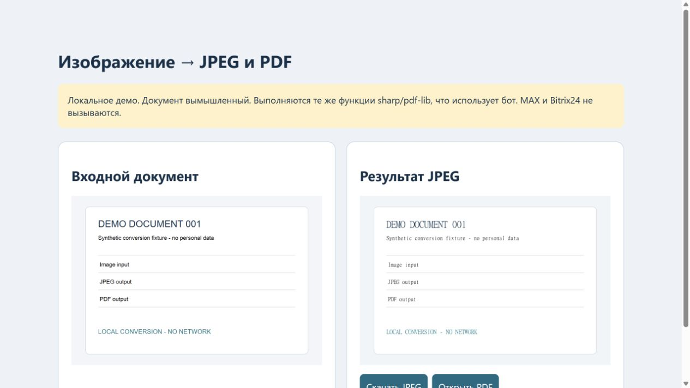

# Конвертер изображений для MAX
Бот принимает фото и файлы изображений, собирает короткие серии сообщений, преобразует результат в JPG/PDF/BOTH и отправляет в MAX. Поддерживается необязательная загрузка в Bitrix Drive. Стек: Node.js, axios, sharp, pdf-lib.

## Посмотреть без аккаунтов
```sh
npm ci
npm test
npm run demo
# http://127.0.0.1:8792
npm run demo:files
```
В демо используется вымышленный SVG. Реальные функции конвертации общие с ботом; внешние API не вызываются. JPEG/PDF формируются при запросе и сохраняются CLI в demo/generated.

## Рабочий режим
Скопируйте .env.example в локальный .env и получите свои тестовые учётные данные. `npm start` запускает polling. Не используйте рабочие документы для публичной демонстрации. Для MAX при необходимости укажите доверенный CA через MAX_TRUSTED_CA_FILE; проверка TLS не отключается.

Серверные логи, пользовательские настройки, marker, ключи и конкретный restart.sh в эту демонстрационную копию не входят. Это отдельная очищенная поставка; она не меняет видимость приватного проекта. Сквозные MAX/Bitrix сценарии требуют отдельной интеграционной приёмки. Лицензию проекта владелец пока не назначил.

## Проверка и реальный экран

[Результаты и ограничения проверки](docs/verification.md). Скриншот получен при локальном запуске на вымышленных данных.


